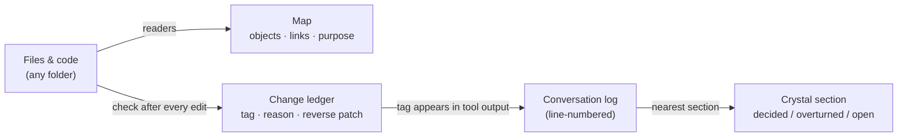

# Progress Map

**Where everything is now — and why it changed.**

A file-and-code map for people who build software by talking to an AI every day.
It keeps the *current* state of every file, and a change ledger in which **every edit carries a reason and a reverse patch** — tied back to the conversation section that caused it. No git.

-yellow)

---

## The problem

When an AI writes most of the code, three things go missing:

| What goes missing | What happens |
|---|---|
| **Where things are** | A new session searches for files by name, lands in the wrong one, and misses the conversation where the design was decided yesterday. |
| **What was lost** | An edit removes 88 lines of a stylesheet while adding others elsewhere. The file only shrinks by 47 lines, so nobody notices. |
| **Why it changed** | git records *what* changed. In conversational development the *why* lives in the chat, which git never sees. Commit messages written after the fact are thin. |

## How it works

1. **Map** — readers walk a folder and record each object (one row per file): what it is for (its first comment line), its size, a fingerprint, and its links (*loads, links, defines, uses, imports, refers*). Readers exist for code (html, js, css, py, ps1, md, json …) and for office files (only the zip directory is read). Column names are generic; topic-specific words are stored as key–value facets, so the same tables serve any project.
2. **Check after every edit** — right after a file is changed, `check(path, reason)` compares it with the stored copy, counts the **removed lines themselves** (not the net total), and appends one ledger row: a tag such as `chg:<session>-0007`, the reason, and a **reverse patch** that turns *now* back into *before*. Large removals raise an ALERT and the work stops.
3. **Tag → conversation** — the tag is part of the tool's output, so it is written into the conversation log. When you open the map later, the tag is found in the log and linked to the nearest crystal section. The link is computed when you look, not stored.
4. **Walk back** — the present is kept whole. To go back, reverse patches are applied newest-first, each step verified by a fingerprint. A full snapshot is taken once a month as a foothold if the chain ever breaks. Restoring is assembled in memory first and written only after a human agrees.

Everything lives in the same DuckDB file as the conversation memory, so one query can go from *file → change → reason → conversation section → original lines*.

## Why not git

git is excellent for teams. For one person and an AI, the cost is in the wrong place:

| | git | Progress Map |
|---|---|---|
| Unit of history | Commit, written by a person | Every checked edit, written automatically |
| The *why* | Commit message, after the fact | Reason given at edit time + link to the conversation |
| Detecting a silent loss | Read the diff | Removed lines are counted; ALERT stops the work |
| Going back | Checkout / revert | Reverse patches, verified step by step |
| Branches and merges | Yes | **Deliberately not built** — for one builder and an AI they add ceremony, not safety |

The line we drew: the moment we start building branches and merges, we are rebuilding git — and we stop.

## Measured

- First build of a 51-file web app: **1.44 s**; second pass with no changes: **0.39 s** (2026-10-04)
- Opening a topic: **0.36 s**; locating one file: **0.08 s**
- Restore test: four versions with mixed CRLF/LF and a missing final newline were restored **byte-for-byte**; a corrupted patch fell back to the snapshot; with no snapshot, it stopped and named the broken step
- In daily use today: **2** topics, **6,258** objects, **7,548** ledger rows (2026-11-07)

When a folder of spreadsheets was reorganized (about 2,300 files moved at once), the map learned to recognise moves by *size, timestamp and name* and carry each file's history to its new place instead of logging delete + create.

## What is (and isn't) here

This repository is a **dated public record of the design**. The implementation is not published.
To talk about building something like it, reach out through **[subtractlab.com](https://subtractlab.com)**.

**Related:** [MeaningSpace](https://github.com/subtractlab/meaningspace) (the conversation memory this map is tied to) · [threshold-skills](https://github.com/subtractlab/threshold-skills)

---

Part of **[SubtractLab](https://github.com/subtractlab)** · Author: 奥田剛司 (Koji Okuda) · [subtractlab.com](https://subtractlab.com) · 日本語: [README.ja.md](README.ja.md)
